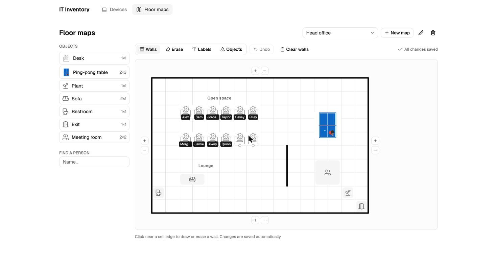
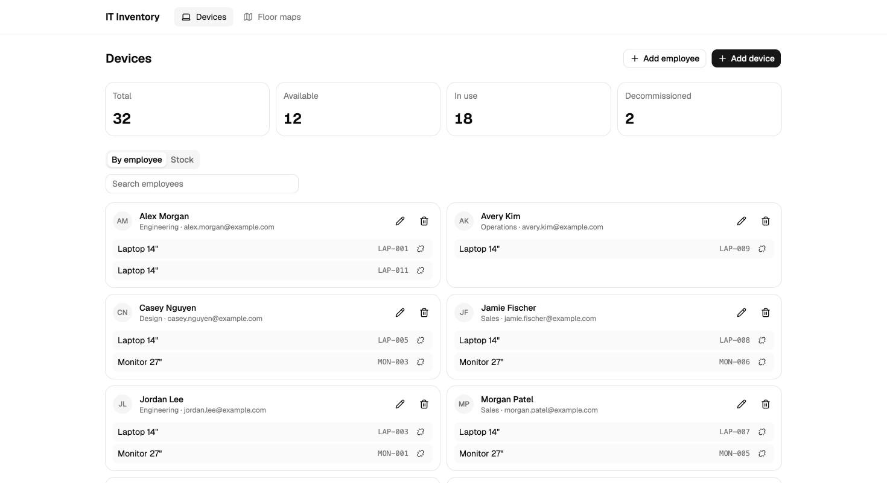

# IT Inventory

Track the company's IT equipment, who has it, and where everyone sits — with an interactive office floor-map
editor.





## Features

- **Devices**: batch creation with sequential asset codes (`LAP-009` → `LAP-010`), assign / unassign,
  decommission / reactivate, stock view with status filter and search, live stats.
- **Employees**: create, edit, delete — deleting someone frees their devices and their desk automatically.
- **Floor maps**: draw walls, place and rotate furniture on a grid, label areas, resize the office. Overlaps are
  rejected, every change autosaves, and desks are assigned to people with their devices one hover away.
- **Pong**: the ping-pong table on the map is playable.

## Highlights

- **Clean Architecture by module** — `employees`, `devices` and `floor-maps` each have `domain`, `application` and
  `infrastructure` layers, never import each other and are wired in a single composition root.
  See the [architecture guide](docs/ARCHITECTURE_GUIDE.md).
- **Integrity in the database, not in hope** — foreign keys with `ON DELETE SET NULL`, a `CHECK` that keeps retired
  devices unassigned, device status derived instead of stored, atomic conditional writes for assignments.
- **Optimistic locking** for the map autosave: two tabs can't silently overwrite each other (`409` + reload).
- **One HTTP contract** (`packages/contracts`, Zod) validates requests in the API and types the web app.
- **Small files by rule** — at most 200 lines per file, enforced in CI.
- Every decision is written down in [ADR.md](docs/ADR.md).

## Tech stack

| Layer   | Tools                                                                         |
| ------- | ----------------------------------------------------------------------------- |
| API     | Node 24, Fastify 5, Prisma 7, PostgreSQL 17, Zod 4                            |
| Web     | React 19, Vite 8, TanStack Query 5, React Router 7, Tailwind CSS 4, shadcn/ui |
| Quality | TypeScript (strict), Vitest, Testing Library, Biome, GitHub Actions           |

## Quick start

Requirements: Node 24, pnpm 12, Docker.

```bash
pnpm install                         # also generates the Prisma client
pnpm db:up                           # PostgreSQL on localhost:5433
cp apps/api/.env.example apps/api/.env
cp apps/web/.env.example apps/web/.env
pnpm --filter api db:migrate
ALLOW_DATA_RESET=true pnpm --filter api seed   # fictional demo data
pnpm --filter api dev                # http://localhost:3000
pnpm --filter web dev                # http://localhost:5173
```

## Scripts

| Command                              | What it does                                                              |
| ------------------------------------ | ------------------------------------------------------------------------- |
| `pnpm lint` / `pnpm lint:fix`        | Biome lint and format                                                     |
| `pnpm check:lines`                   | Fails if a file exceeds 200 lines (300 for tests)                         |
| `pnpm typecheck`                     | Type checks every package                                                 |
| `pnpm test`                          | Unit tests of every package                                               |
| `pnpm --filter api test:coverage`    | API unit tests with the 85% coverage threshold                            |
| `pnpm --filter api test:integration` | Repository tests against the PostgreSQL in `DATABASE_URL`                 |
| `pnpm build`                         | Builds every package                                                      |
| `pnpm --filter api seed`             | Wipes the database and loads demo data (requires `ALLOW_DATA_RESET=true`) |

## API

All responses use the envelope `{ "status": "OK", "data": … }` or `{ "status": "ERROR", "message": "…" }`.

| Method         | Path                                                               | Description                                                                |
| -------------- | ------------------------------------------------------------------ | -------------------------------------------------------------------------- |
| GET            | `/health`                                                          | Liveness check                                                             |
| GET / POST     | `/employees`                                                       | List (`page`, `limit`, `search`, `department`) / create                    |
| PATCH / DELETE | `/employees/:id`                                                   | Update (`null` clears a field) / delete                                    |
| GET / POST     | `/devices`                                                         | List (`page`, `limit`, `status`, `search`, `employeeIds`) / create a batch |
| GET            | `/devices/stats`                                                   | Totals by status                                                           |
| PATCH / DELETE | `/devices/:id`                                                     | Update name, code or notes / delete                                        |
| PATCH          | `/devices/:id/assign` · `unassign` · `decommission` · `reactivate` | Status transitions                                                         |
| GET / POST     | `/floor-maps`                                                      | List / create                                                              |
| PATCH / DELETE | `/floor-maps/:id`                                                  | Rename / delete                                                            |
| PUT            | `/floor-maps/:id/layout`                                           | Save walls, labels and objects (requires the current `version`)            |
| PATCH          | `/floor-maps/:id/objects/:objectId/assign`                         | Assign a desk (`null` frees it)                                            |

Errors: `400` invalid input · `404` not found · `409` conflict (duplicate or stale version) · `422` business rule ·
`429` rate limit.

## Environment variables

| App | Variable           | Default                 | Description                               |
| --- | ------------------ | ----------------------- | ----------------------------------------- |
| api | `DATABASE_URL`     | —                       | PostgreSQL connection string              |
| api | `PORT` / `HOST`    | `3000` / `0.0.0.0`      | Listen address                            |
| api | `CORS_ORIGINS`     | `http://localhost:5173` | Comma-separated allowlist                 |
| api | `TRUST_PROXY_HOPS` | `0`                     | Proxies in front of the API (1 on Render) |
| web | `VITE_API_URL`     | `http://localhost:3000` | API base URL                              |

## Deployment

`render.yaml` deploys the API (migrations run before each deploy), `netlify.toml` builds the web app, and the
`Reset demo data` workflow reloads the fictional data every night once the `DEMO_DATABASE_URL` secret is set.
The public demo has no login by design: rate limiting and the nightly reset keep it usable
([ADR-005](docs/ADR.md#adr-005--no-authentication-in-the-public-demo)).

## License

[MIT](LICENSE) © Iván Nieto Abarca
