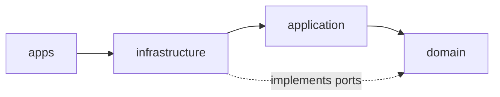

# Architecture Guide

How the code is organised, how a request flows through it and how to add a feature. The reasons behind each choice
are in [ADR.md](./ADR.md).

## Repository layout

```
apps/
  api/                 Fastify + Prisma (PostgreSQL)
  web/                 React + Vite + TanStack Query + Tailwind + shadcn/ui
packages/
  contracts/           Zod schemas of the HTTP API, shared by both apps
docs/                  this guide and the ADRs
scripts/               repository tooling (line-limit check)
```

## API

```
apps/api/src/
  apps/
    http/              entry point: config, server, container (composition root), routes, middlewares
    seed/              entry point: wipes and loads the demo data
  modules/
    employees/  devices/  floor-maps/
      domain/          aggregates, value rules, ports (interfaces only)
      application/     one folder per use case
      infrastructure/
        persistence/   Prisma repositories and mappers
        api/           schemas, handlers (one per use case), routes
  shared/
    domain/            DomainError hierarchy
    infrastructure/    validate preHandler, ok/fail envelope, error handler, Prisma client
```

### Dependency rule



- `domain` imports nothing but `shared/domain`. Ports are declared here.
- `application` imports only `domain`: it depends on ports, never on Prisma or Fastify.
- `infrastructure` implements the ports (`persistence/`) and exposes the use cases over HTTP (`api/`).
- A module never imports another module. If `devices` needs to know whether an employee exists, it declares
  `IEmployeeLookup` in its own domain and implements it in its own infrastructure.

### Request flow

`PATCH /devices/:id/assign` as an example:

1. **Route** (`devices.routes.ts`): runs `validate(DeviceParamsSchema, 'params')` and
   `validate(AssignDeviceBodySchema)` from the contract. Malformed input stops here with `400`.
2. **Handler** (`AssignDeviceHandler`): maps the request to a command and calls the use case. No logic, no
   `try/catch`.
3. **Use case** (`AssignDevice`): loads what it needs through ports, applies the domain rule, persists through the
   repository port and returns a view (never the aggregate).
4. **Aggregate** (`Device`): owns the invariants. Breaking one throws a typed `DomainError`.
5. **Repository** (`PrismaDeviceRepository`): the only code that talks to the database.
6. **Error handler**: maps `ValidationError` → 400, `NotFoundError` → 404, `ConflictError` → 409,
   `BusinessRuleViolationError` → 422, anything else → 500 without details.

Every response uses the same envelope: `{ status: 'OK', data }` or `{ status: 'ERROR', message }`.

### Wiring

Each module exports a `build…Handlers(database)` function from its routes file: the only place where its
repositories, use cases and handlers are instantiated. `apps/http/container.ts` calls them and `apps/http/routes.ts`
registers each module under its prefix.

## Adding a feature

In this order; each step should compile before the next one.

1. Aggregate rule or new aggregate — `modules/<m>/domain/`
2. Port changes — `modules/<m>/domain/`
3. Use case folder with its spec (ports doubled) — `modules/<m>/application/<UseCase>/`
4. Contract schema — `packages/contracts/src/<m>/`
5. Mapper and repository — `modules/<m>/infrastructure/persistence/`
6. Handler and route — `modules/<m>/infrastructure/api/`
7. Wiring in the module's `build…Handlers()`
8. Migration and indexes if the schema changes — `apps/api/prisma/`
9. Integration test of the repository (`*.int.spec.ts`)

## Web

```
apps/web/src/
  app/                 router, providers, layout
  features/<feature>/  api/ (requests + TanStack Query hooks), hooks/, components/, lib/
  shared/
    api/               httpClient: unwraps the envelope, throws ApiError(message, status)
    ui/                shadcn/ui components (lowercase, vendor code) + own components (PascalCase)
    lib/               small pure helpers
```

- Server state lives in TanStack Query; mutations invalidate the queries they affect. Client errors (4xx) are not
  retried.
- Features don't import each other's internals; shared building blocks go to `shared/`.

## Testing

| Level       | Where                                                  | What                                                                                                                  |
| ----------- | ------------------------------------------------------ | --------------------------------------------------------------------------------------------------------------------- |
| Unit        | `*.spec.ts` next to the code                           | aggregates, use cases with in-memory adapters, handlers through Fastify `inject`, web components with Testing Library |
| Integration | `*.int.spec.ts` (`pnpm --filter api test:integration`) | Prisma repositories against a real PostgreSQL                                                                         |

API coverage must stay at or above 85% (`pnpm --filter api test:coverage`). CI runs lint, the line-limit check,
type checks, unit tests, the build and the integration suite against a PostgreSQL service.

## Conventions

- TypeScript strict everywhere; Biome for lint and format.
- Files: PascalCase for classes and React components, `useX` for hooks, kebab-case or camelCase for function modules.
- At most 200 lines per file (300 for tests): `pnpm check:lines`.
- Conventional commits in English.
